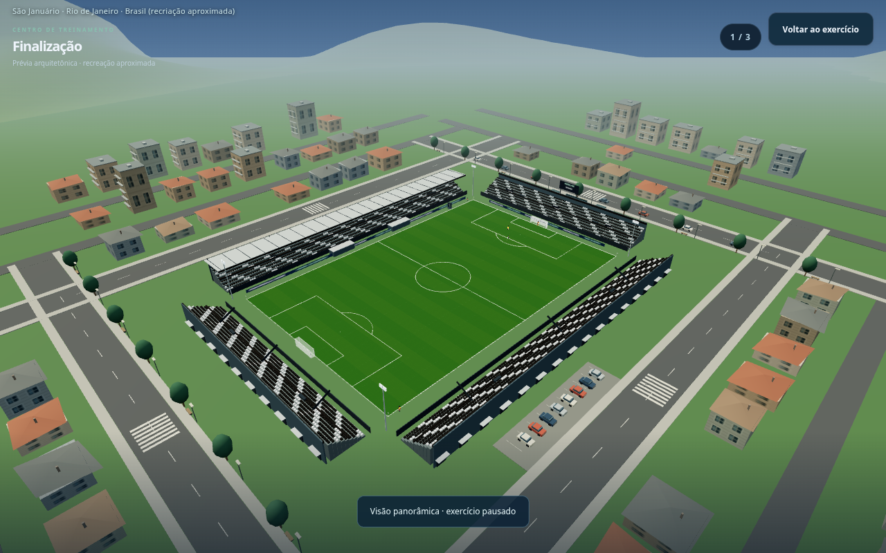
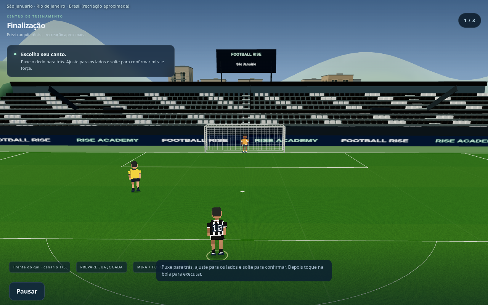
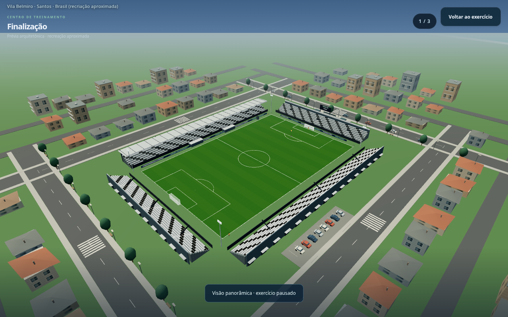
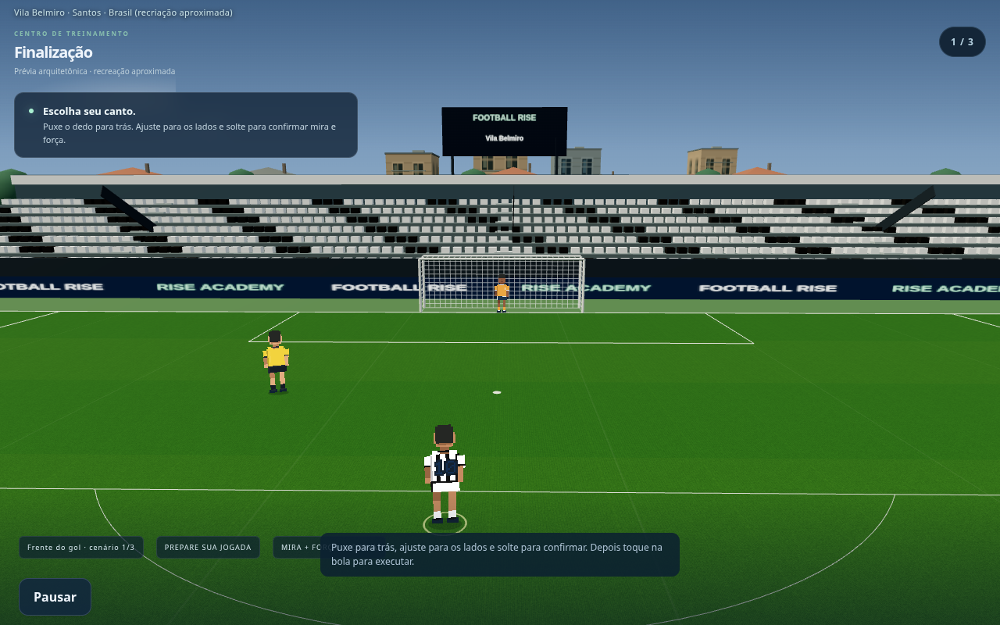
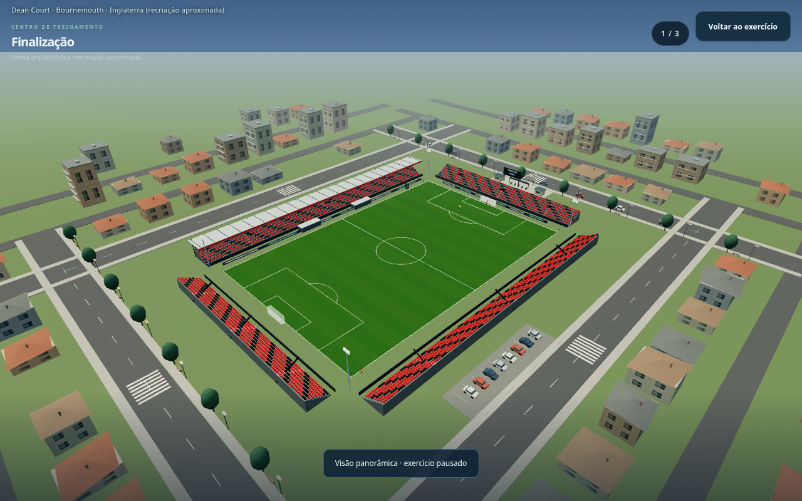
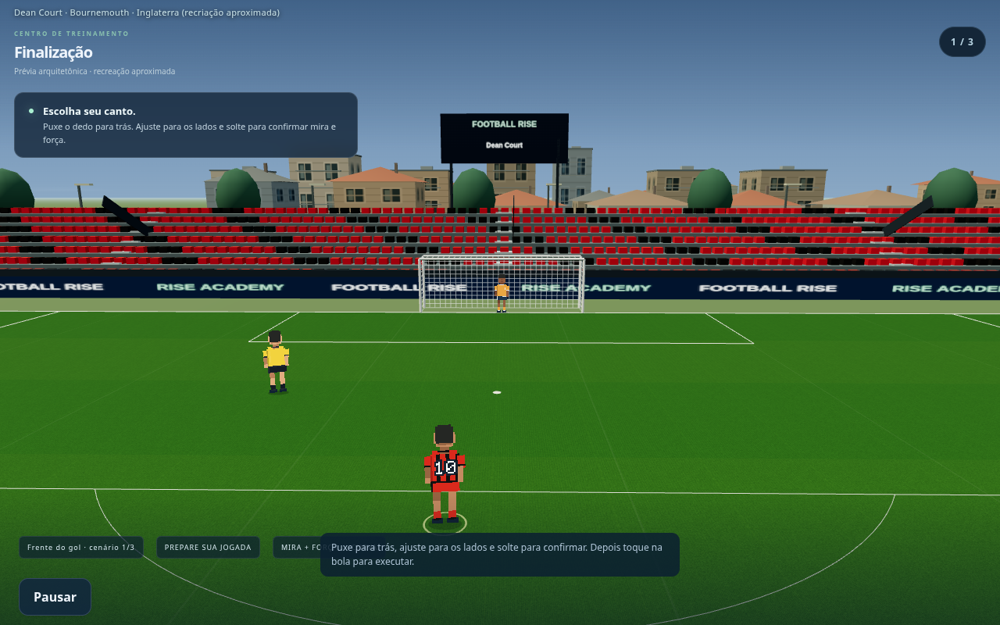
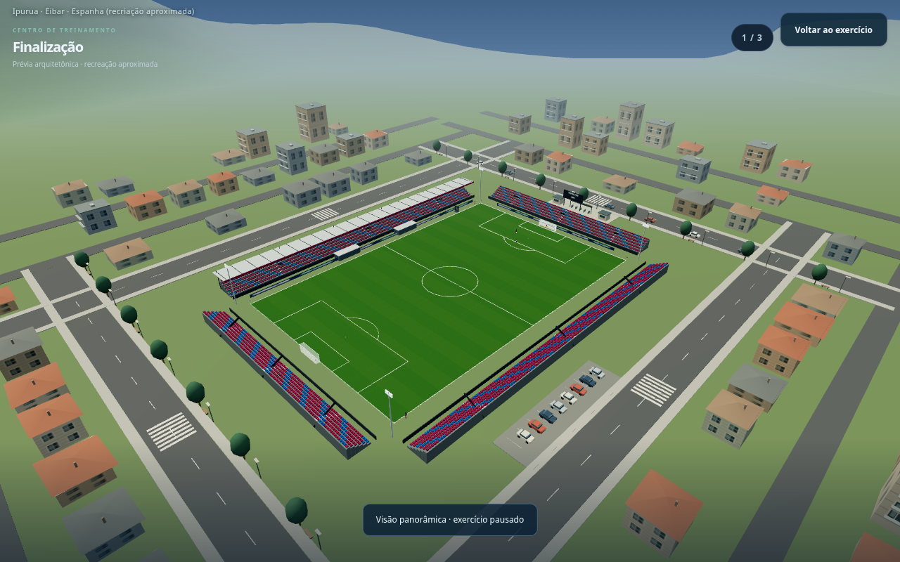
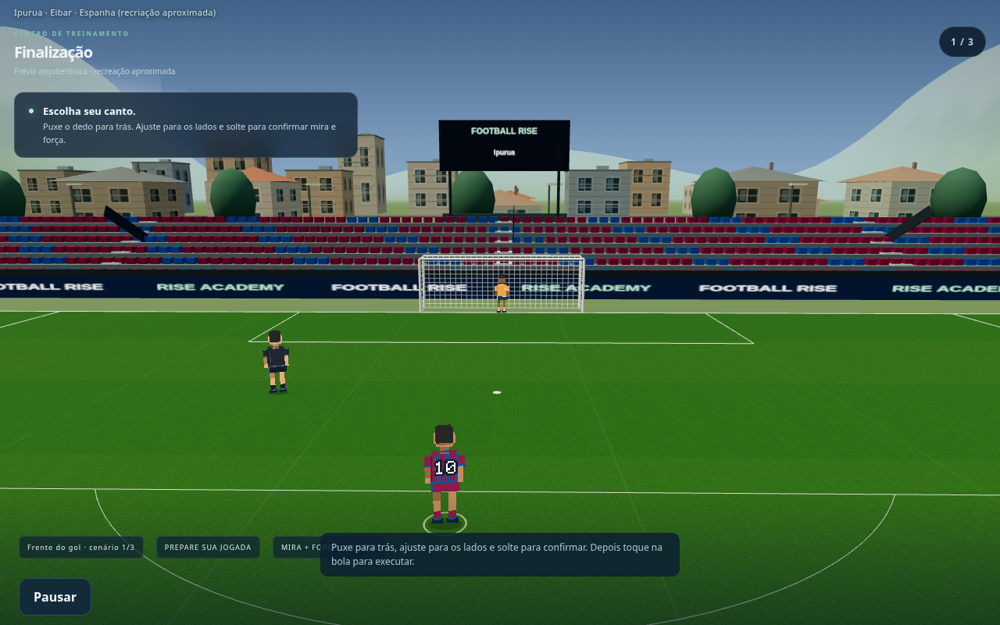

# Football Rise — entorno dos estádios abertos

**Capturas reais da versão em desenvolvimento, para revisão. O jogo público ainda não foi atualizado.**

O entorno ganhou quarteirões, casas e edifícios baixos com fachadas e telhados, ruas conectadas, calçadas, travessias, portões/bilheterias, estacionamento, carros com rodas e vidros, árvores, postes e bancos. O bairro acompanha também estádios em cenários de montanha e litoral; o mar fica distante, sem praia colada na arquibancada.

O objetivo desta revisão é melhorar a paisagem vista de dentro dos estádios abertos. São cenários procedurais aproximados, sem reprodução geográfica exata das ruas reais.

## São Januário — bairro e acessos

## Vila Belmiro — entorno de um estádio menor

## Dean Court — estádio pequeno e aberto

## Ipurua — bairro e relevo distante

## Maracanã — comparação em uma arena grande

[Baixar estas imagens](previas-entorno.zip) · [Prévia dos estádios por clube](previas-estadios.md) · [Treinos e VAR](previas-treinos.md) · [Mira sem alvo final](previas-mira-var.md)
