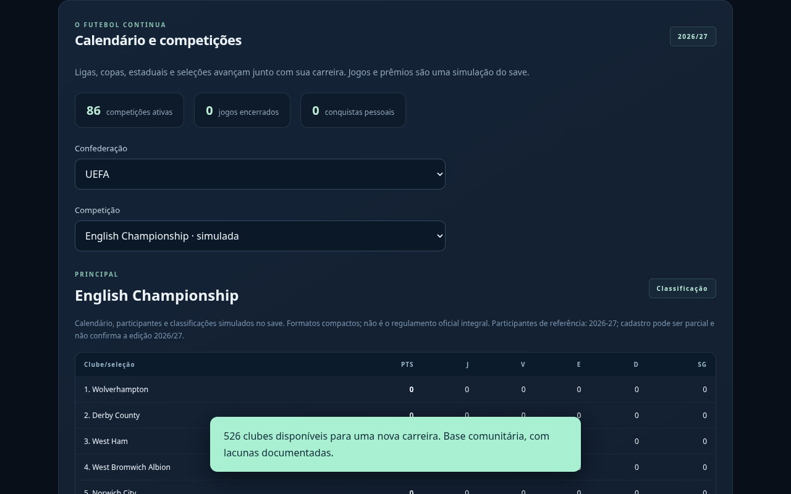
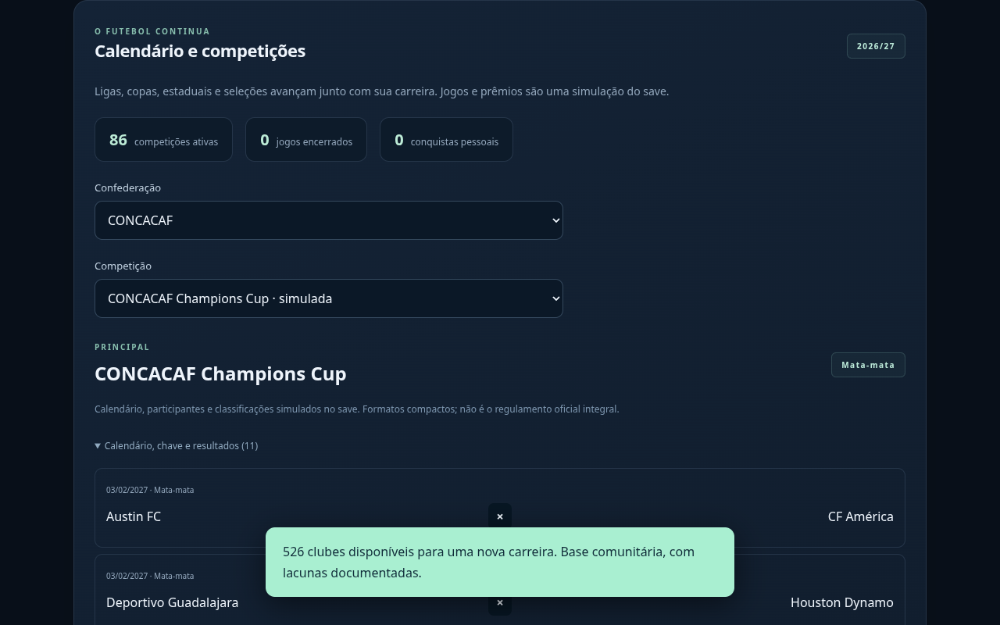
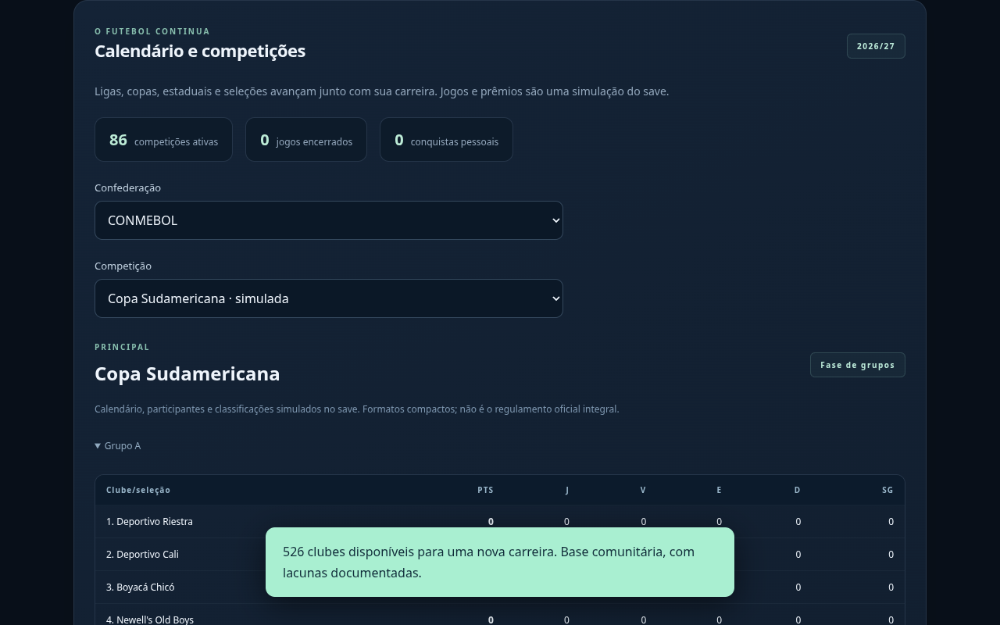
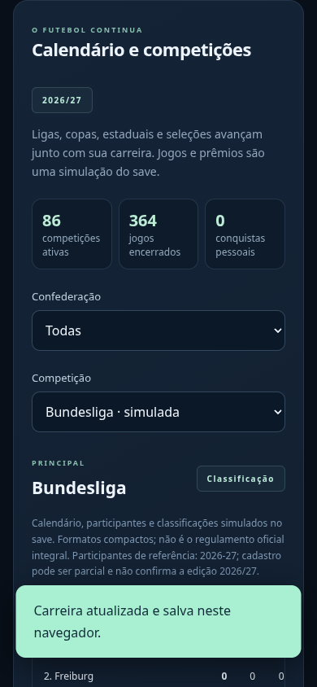

# Football Rise — ligas e divisões UEFA, CONMEBOL e CONCACAF

**Capturas reais da versão em desenvolvimento. O jogo público ainda não foi atualizado.**

O catálogo organiza 106 associações (55 UEFA, 10 CONMEBOL, 41 CONCACAF), com 105 referências de primeira divisão; Liechtenstein não possui liga nacional própria. O pacote ampliado contém **526 clubes e 26 divisões com dados disponíveis em 17 sistemas nacionais**, incluindo divisões inferiores. As demais ligas aguardam participantes/dados; não são todas jogáveis nesta base.

São referências factuais e edições simuladas, **sem licenciamento comercial oficial**. Os snapshots vão de 2024/25 a 2026/27: dados históricos não confirmam participantes de 2026/27. Novos clubes não recebem elencos reais inventados; parâmetros e uniformes adicionais são procedurais.

## Segunda divisão separada da primeira

## CONCACAF Champions Cup

## Copa Sudamericana

## Navegador de celular

Os testes passaram para divisões, filtros, calendário autônomo, salvamento/recarga e controles no computador/celular. Os formatos são compactos; não há reprodução integral de regulamentos nem promoção/rebaixamento completo.

[Baixar estas imagens](previas-ligas.zip) · [Lista das divisões e temporadas disponíveis](ligas-divisoes.md) · [Estádios e torcida](previas-identidades.md) · [Treinos e VAR](previas-treinos.md)
