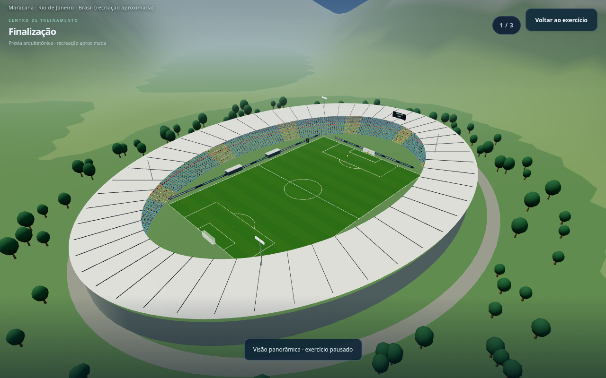
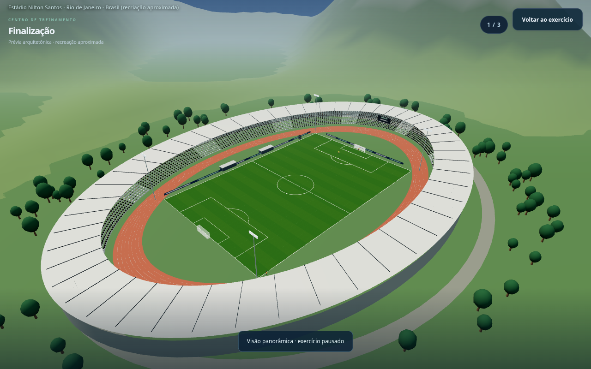
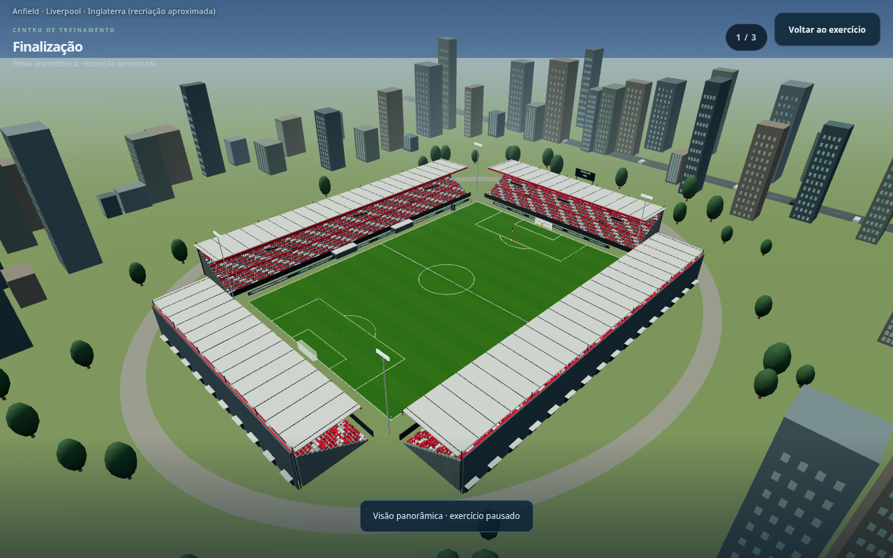
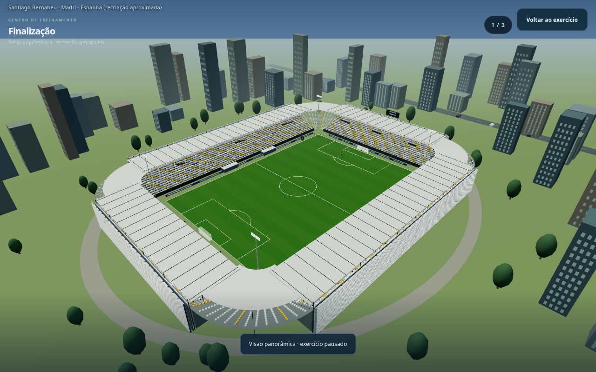
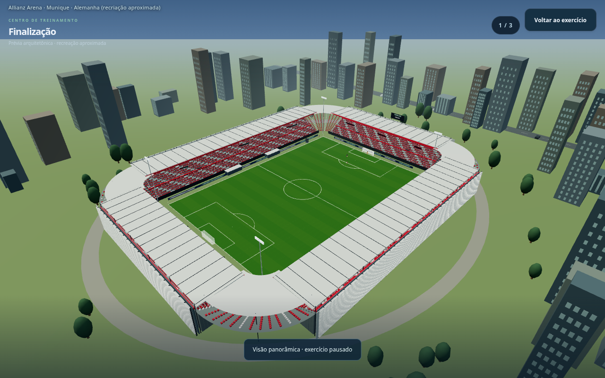
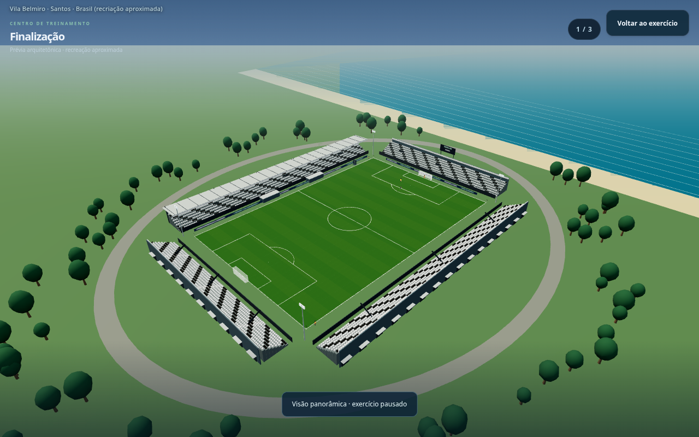
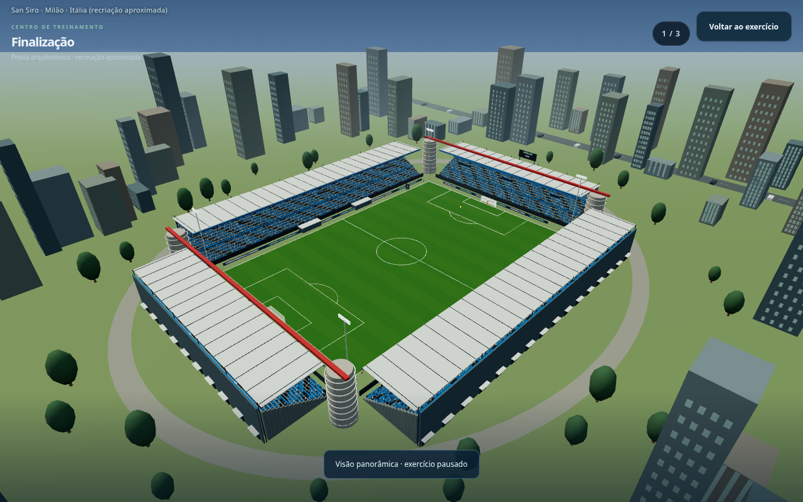

# Football Rise — estádios por clube, VAR e treinos

**Capturas reais da versão em desenvolvimento. O jogo público ainda não foi atualizado.**

Os 238 clubes do catálogo têm um estádio de referência histórica associado. Há formatos retangulares, bowls e ovais, coberturas, fachadas, pistas, assentos e entornos diferentes. Clubes que dividem estádio mantêm o mesmo local, como Flamengo/Fluminense e Inter/Milan.

São **recriações procedurais aproximadas**, sem modelos ou imagens oficiais. As capacidades são faixas visuais arredondadas. Reformas, nomes patrocinados e mandos temporários de 2026/27 ainda precisam de confirmação; estas imagens não representam uma reconstrução arquitetônica exata.

## Maracanã — Flamengo e Fluminense

## Nilton Santos — Botafogo

## Anfield — Liverpool

## Santiago Bernabéu — Real Madrid

## Allianz Arena — Bayern

## Vila Belmiro — Santos

## San Siro — Inter e Milan

## VAR de costas para a câmera, voltado às telas

[Baixar as imagens](previas-estadios-treinos.zip) · [Ver os ajustes nos quatro treinamentos e no celular](previas-treinos.md) · [Mira sem alvo final](previas-mira-var.md) · [Uniformes da arbitragem](previas-arbitragem.md)
