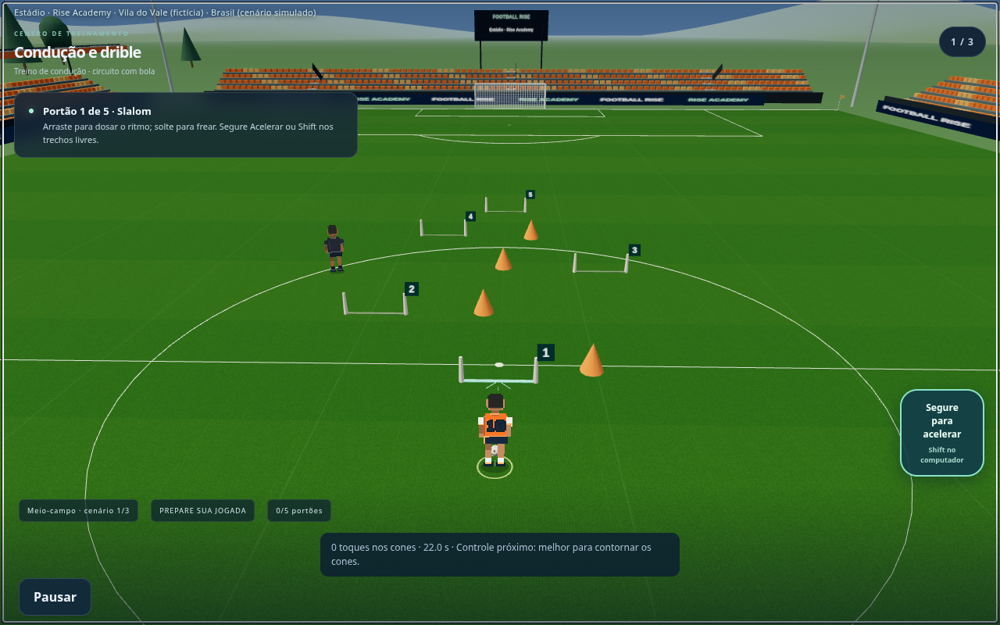
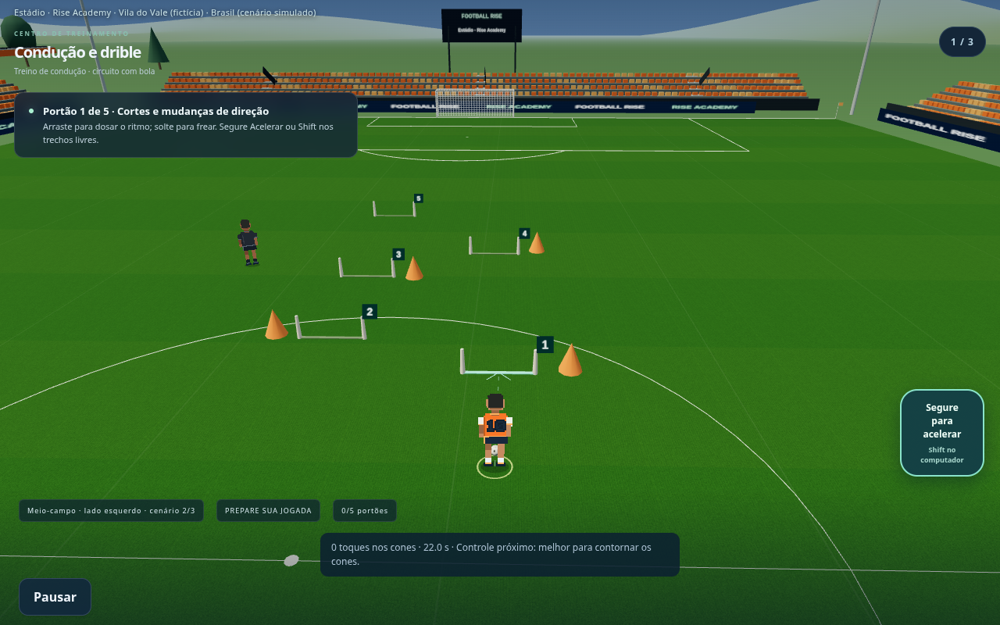
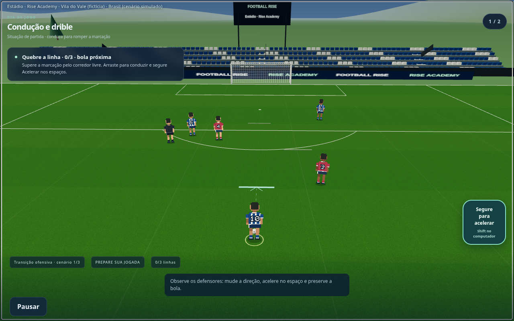
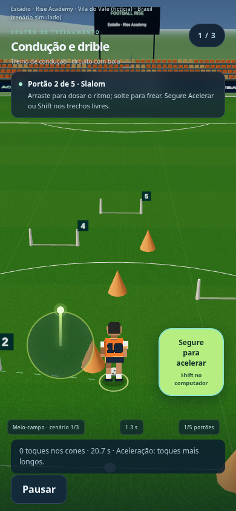
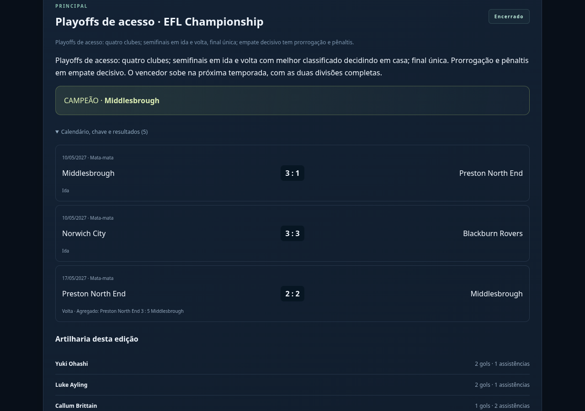
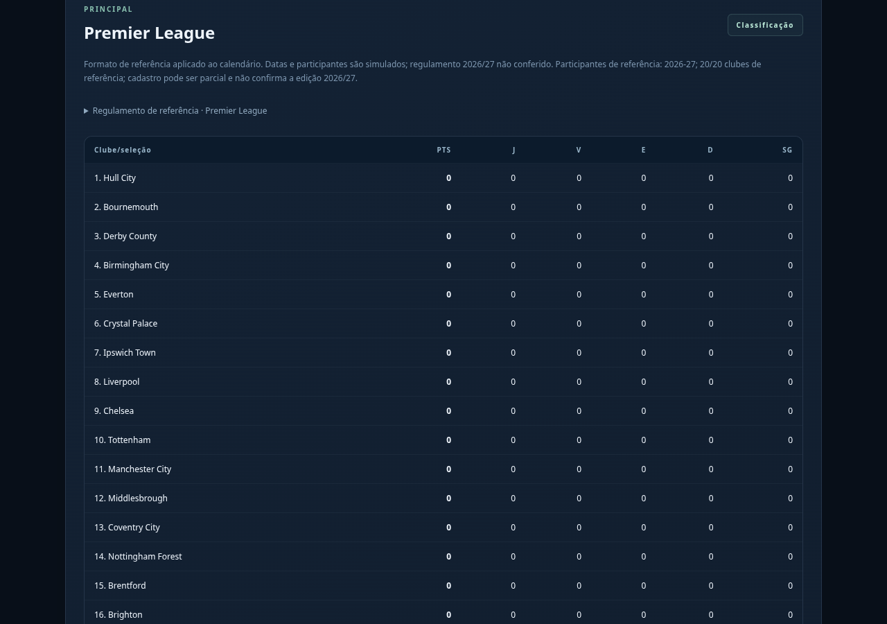

# Football Rise — condução de bola e avanço de temporada

**Capturas reais da versão em desenvolvimento. Publicação do jogo ainda aguarda aprovação visual.**

## Treinos de condução com portões numerados

Três percursos diferentes: slalom, cortes/mudanças de direção e zigue-zague. O próximo trecho fica indicado no gramado. A bola e os pés acompanham o deslocamento; colisões com cones prejudicam a nota.

## Condução durante a partida

Defensores pressionam a bola e podem recuperar a posse. Há companheiros e corredores de avanço, sem cones nem balizas de treinamento. Condução bem-sucedida prepara a finalização seguinte, usando a posição física da bola ao sair da jogada.

## Direcional e aceleração no celular

Um dedo conduz; o outro segura o botão de aceleração. Soltar freia. No computador, WASD/setas movimentam e Shift acelera. Acelerar aumenta a velocidade, alonga o toque na bola e exige mais cuidado nas curvas. Pausa e cancelamento liberam os comandos.

## Playoffs, prorrogação e troca de divisão

Playoffs ingleses com duas semifinais em ida/volta e final única. Acesso/descenso funciona somente com divisões completas e encerradas. O pacote atual permite o caminho Premier League/Championship; divisões incompletas não inventam participantes.

A próxima temporada mantém os clubes promovidos/rebaixados nas divisões corretas, sem retornar ao snapshot antigo. A regra brasileira troca quatro clubes com duas divisões de 20; a Série B do pacote atual tem 18, portanto esse caminho fica suspenso nele. A regra foi testada com cadastro completo adicional.

Prorrogação foi ligada às fases compatíveis nas novas versões dos regulamentos. Fases de pênaltis diretos continuam distintas; partidas antigas preservam suas regras. Vagas continentais oficiais e acesso/descenso de outros sistemas seguem pendentes.

## Verificação

Testes do domínio e build passaram. O navegador concluiu os três circuitos por teclado, validou pausa/cancelamento, ritmo, pressão adversária, continuidade condução/chute e aceleração com dois dedos. Também encerrou as nove edições especiais, verificou cinco jogos do playoff inglês, exibiu prorrogação e salvou/recarregou a virada com três promovidos e 20 clubes na Premier League.

[Todas as variações e chute após condução](conducao-variacoes.md) · [Baixar as onze imagens](previas-conducao-temporada.zip) · [Controles e comportamento](conducao-controles.md) · [Regras e cobertura](regulamentos-cobertura.md) · [Seis formatos especiais](previas-formatos-especiais.md) · [Estádios e torcida](previas-identidades.md)
