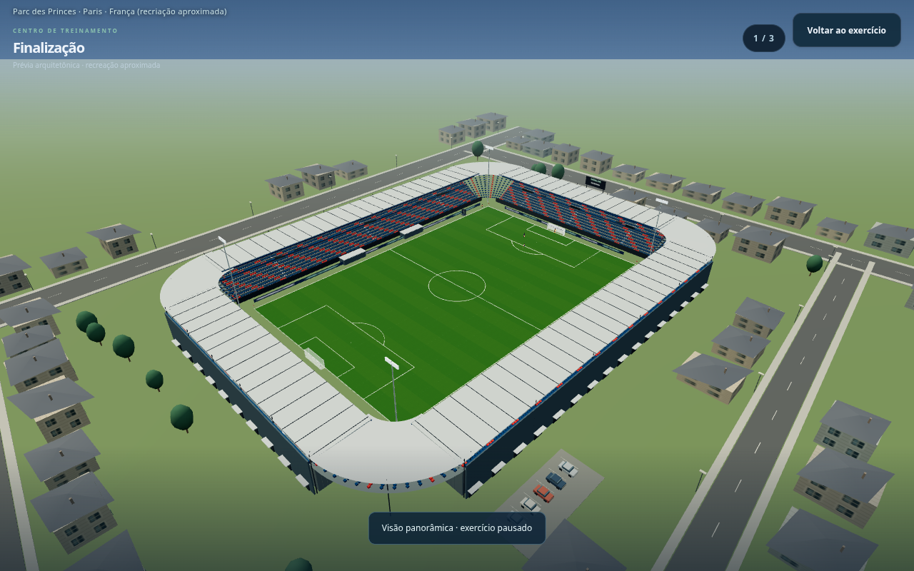
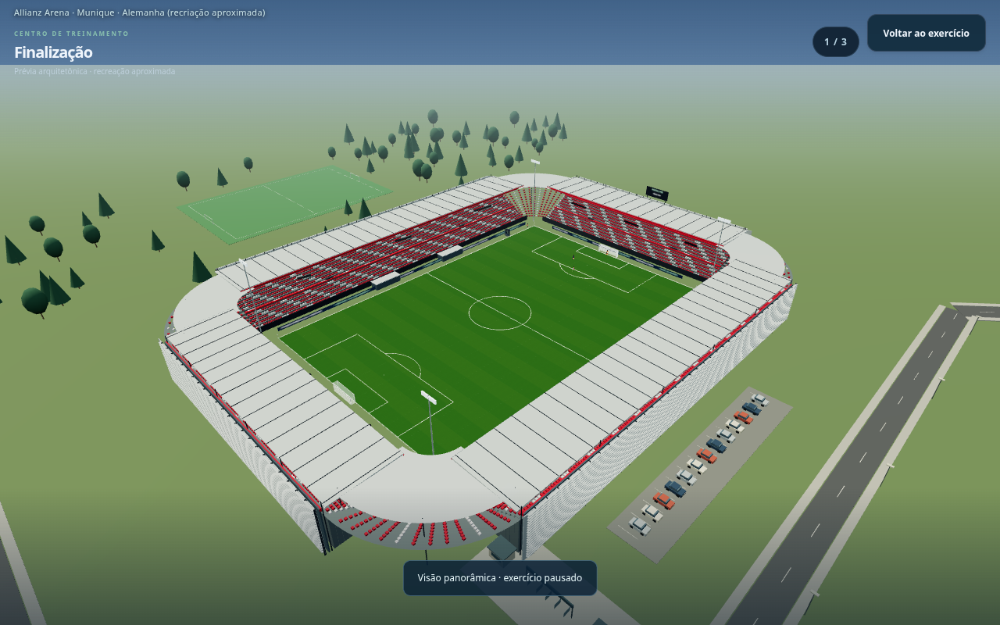
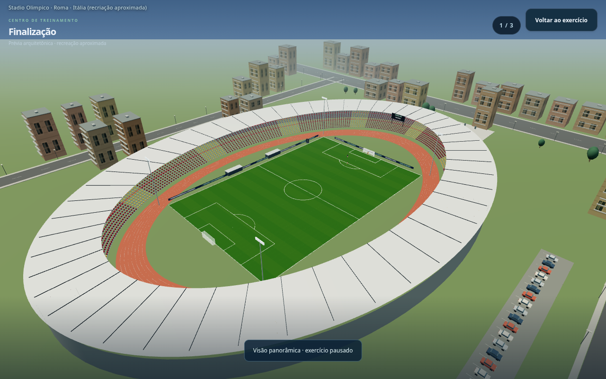
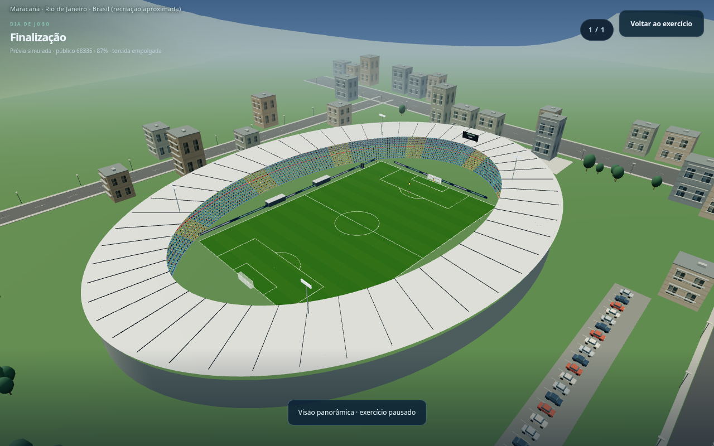
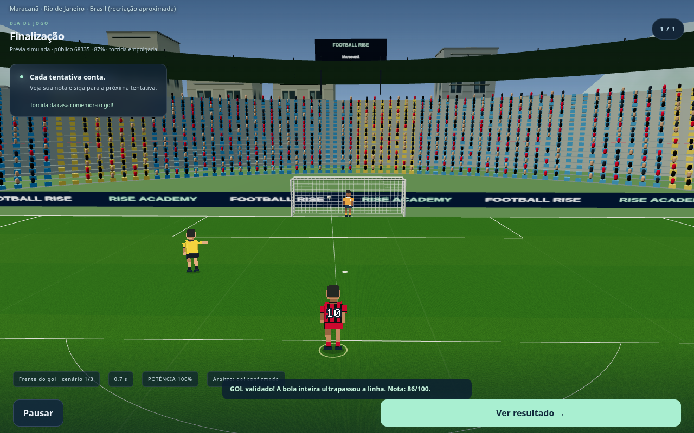
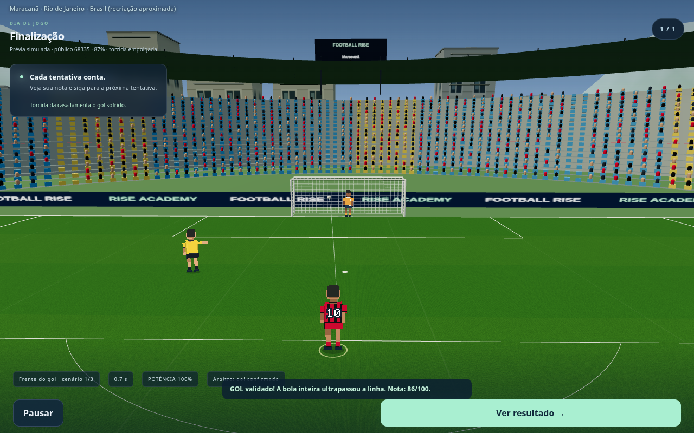

# Football Rise — identidade por estádio e país, torcida por campanha

**Capturas reais da versão em desenvolvimento. O jogo público ainda não foi atualizado.**

O sistema atende todos os **238 clubes do catálogo** — [confira a lista completa de clubes, estádios e países](clubes-estadios.md). Os traçados de ruas/acessos variam por estádio; clubes que dividem o mesmo local mantêm o mesmo cenário. País, cidade, porte e tipologia orientam materiais, telhados, fachadas, vegetação e disposição das construções. Há famílias de objetos reutilizáveis, mas o entorno não repete o mesmo conjunto de quatro ruas. São interpretações aproximadas, sem georreferenciamento das ruas reais.

## São Januário — bairro compacto e acesso histórico estilizado

## Vila Belmiro — casas, comércio e torres residenciais

## Dean Court — parque, bosque e campo auxiliar

## Ipurua — vale, terraços, escadas e apartamentos

## Maracanã — praça, avenidas e corredor de transporte

## França — Parc des Princes

## Alemanha — Allianz Arena

## Itália — Stadio Olimpico

## Torcida — a mesma arena com campanha boa

A ocupação usa a reputação e os seis últimos resultados do mandante. No início sem resultados, a demanda fica neutra. A base atrai menos público que o profissional.

## Torcida — a mesma arena com campanha ruim

## Reação ao gol em casa

## Reação ao gol do visitante

Nos treinos, as arquibancadas ficam vazias. Os sons são sintetizados e respeitam pausa/silêncio; não usam cantos licenciados.

[Baixar as imagens](previas-identidades-torcida.zip) · [Prévia anterior do entorno](previas-entorno-anterior.md) · [Estádios por clube](previas-estadios.md) · [Treinos e VAR](previas-treinos.md)
