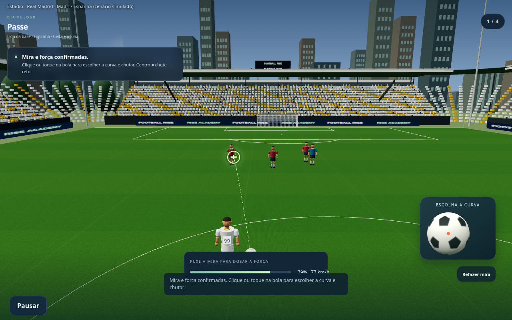
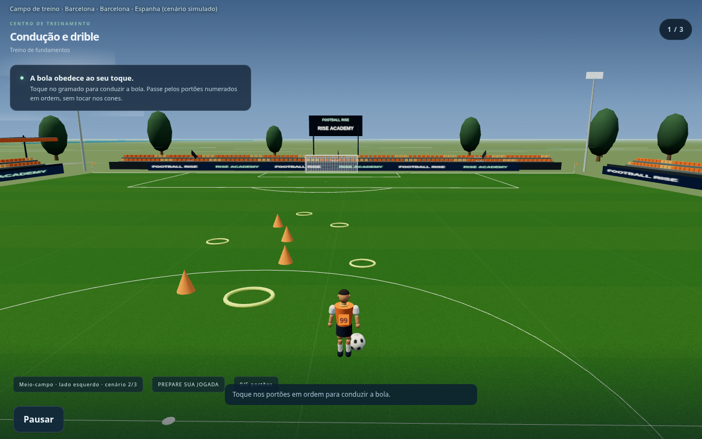
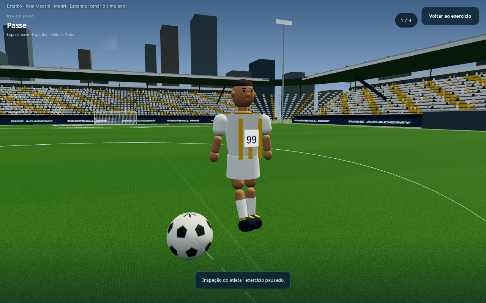

# Football Rise — prévias gráficas e competições

Capturas reais da versão em desenvolvimento. **O jogo público ainda não foi atualizado.** Cenários e uniformes são estilizados; competições, classificações e premiações são simuladas no save, com formatos compactos. A sala de troféus mostra uma carreira de demonstração executada pelas regras do jogo.

Clique nas imagens para ampliar.

## Estádio pequeno no interior

## Arena urbana

## Estádio com montanhas

## Estádio no litoral

## Mira e campo

## Treino no meio-campo

## Detalhes do jogador

## Calendário e competições

## Premiações — carreira de demonstração

[Baixar todas as imagens](previas-v3.zip)
