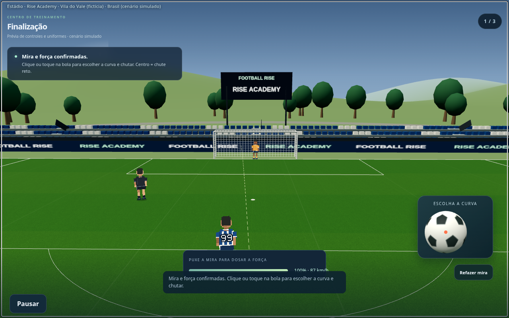

# Football Rise — identificação do VAR e mira sem alvo final

**Capturas reais da versão em desenvolvimento. O jogo público ainda não recebeu estas alterações.**

Cada profissional está identificado na sua bancada: **VAR — árbitro de vídeo**, **AVAR — assistente VAR** e **operador de replay**. Os três continuam sentados, com roupas lisas.

A mira mantém a trajetória, sem o alvo no destino. Puxar para trás define direção e força; soltar confirma. Só então aparece a bola para escolher a curva e chutar com um toque. A puxada curta mantém a direção e ignora pequenos tremores laterais.

## Mira sem alvo no final

## Cada integrante identificado

## Visualização no celular

[Baixar estas imagens](previas-mira-var.zip) · [Uniformes da arbitragem](previas-arbitragem.md) · [Sequência do VAR](previas-var.md) · [Jogadores e animações](previas-pixel-art.md)
