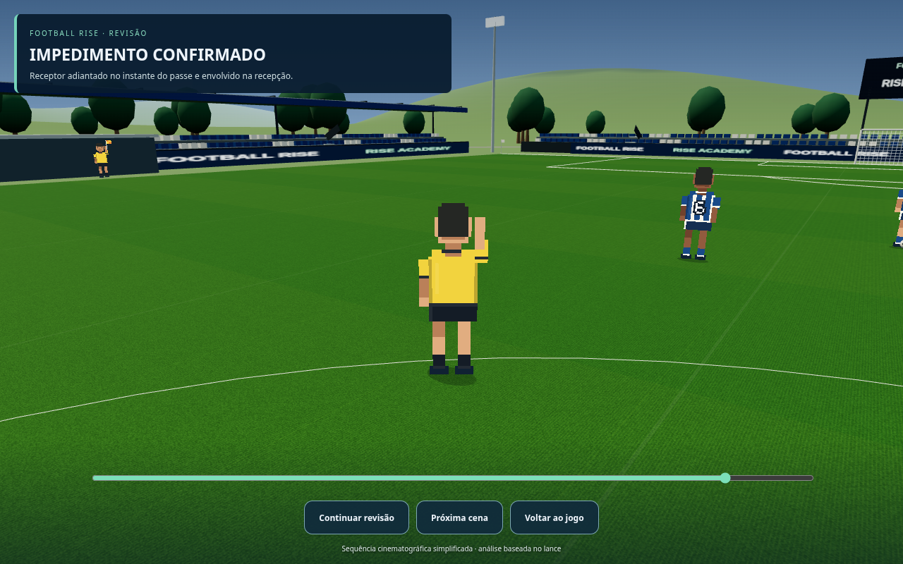
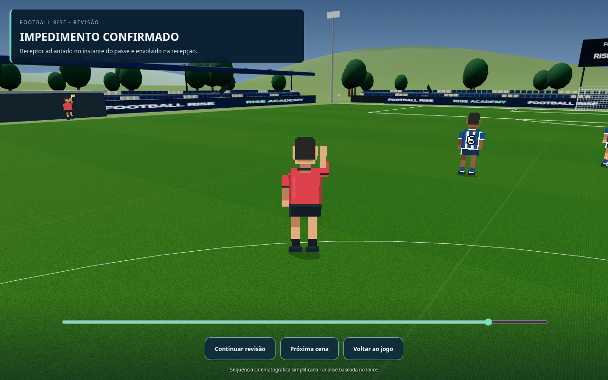
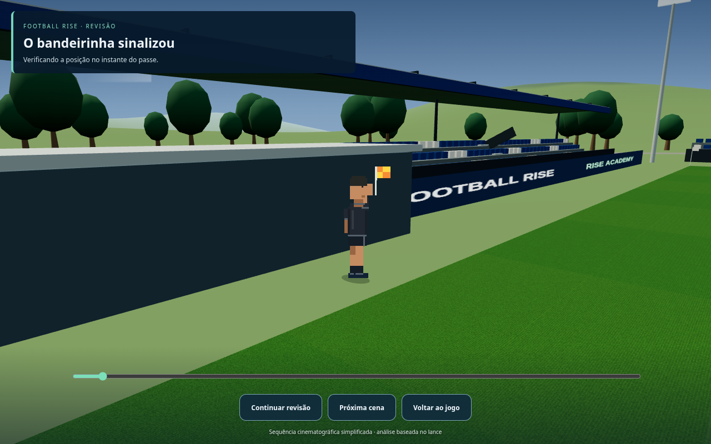
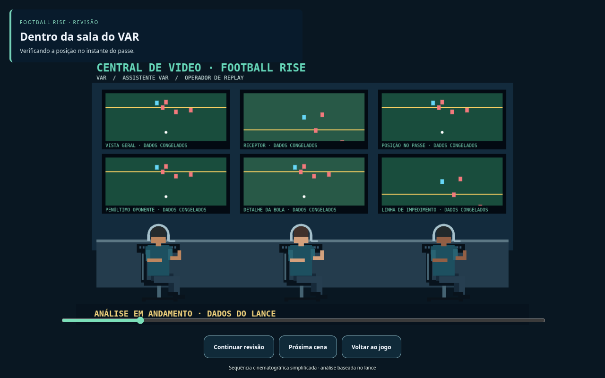
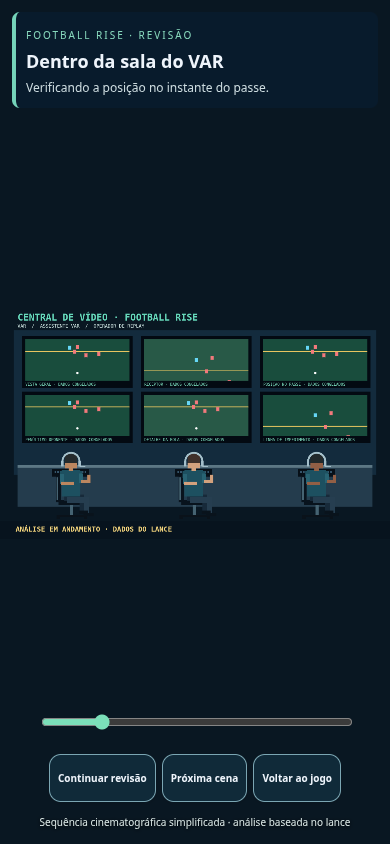

# Football Rise — uniformes da arbitragem e equipe VAR sentada

**Novas capturas da versão em desenvolvimento, para aprovação. O jogo público ainda não foi atualizado.**

Árbitro e bandeirinhas usam roupas lisas, sem números, nomes, patrocínios ou inscrições. Três opções de camisa: preta, amarela e vermelha, com calção e meias pretos. A pausa permite escolher a cor ou seleção automática por contraste. São desenhos originais com a paleta solicitada. Os jogadores continuam numerados.

Na central, os três profissionais aparecem sentados em cadeiras, com joelhos e braços dobrados. As roupas da equipe também são lisas. Telas e decisões do VAR continuam usando os dados congelados do lance.

Clique nas imagens para ampliar.

## Uniforme preto — sem numeração ou inscrições

## Uniforme amarelo — sem numeração ou inscrições

## Uniforme vermelho — sem numeração ou inscrições

## Bandeirinha com roupa lisa

## Três profissionais sentados — braços e joelhos dobrados, cadeiras visíveis

## Equipe sentada na visualização de celular

[Baixar as imagens](previas-arbitragem.zip) · [Sequência completa do VAR](previas-var.md) · [Jogadores e animações](previas-pixel-art.md)
