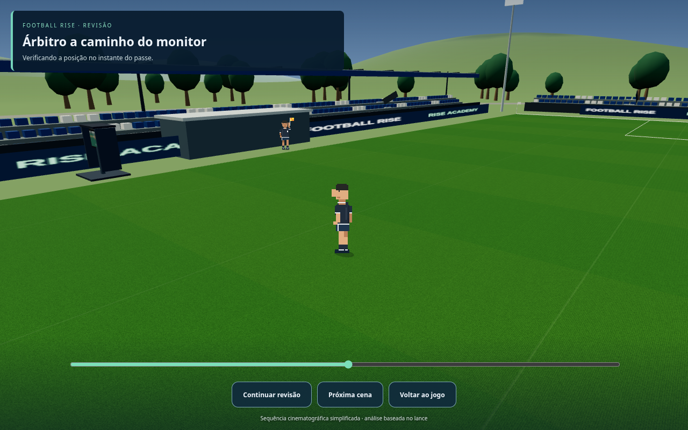
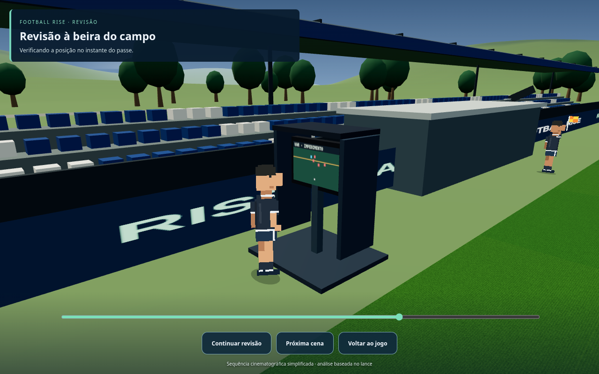
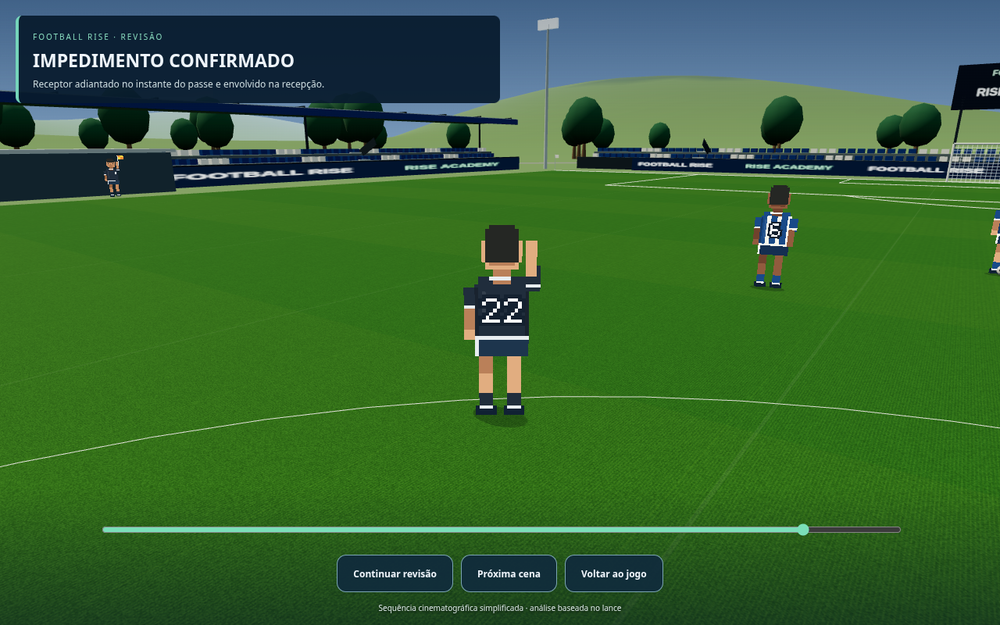

# Football Rise — bandeirinhas e VAR

**Prévias reais da versão em desenvolvimento. O jogo público ainda não foi atualizado.**

A sequência acompanha um impedimento ocorrido na oportunidade jogável: sinal do bandeirinha, central de vídeo, deslocamento do árbitro ao monitor e comunicação da decisão. A sala tem três profissionais (VAR, AVAR e operador de replay), consoles, headsets e seis telas. Monitores e bandeirinha usam os mesmos dados congelados do lance.

Esta é uma apresentação cinematográfica simplificada, ligada às regras atuais de gol e impedimento. As telas mostram reconstruções esquemáticas dos dados, não seis gravações de câmeras. Revisões oficiais completas de faltas, pênaltis e vermelhos ainda não estão implementadas.

A revisão pode ser pausada, avançada ou fechada; o resultado é preservado e registrado uma única vez. Capturas abaixo geradas pelo aplicativo no Chromium, inclusive no tamanho de celular. Clique nas imagens para ampliar.

## Bandeirinha sinalizando um impedimento real da oportunidade

## Sala do VAR — três profissionais, headsets e seis telas

## Árbitro se deslocando até o monitor

## Monitor exibindo os dados do mesmo lance

## Árbitro comunica a decisão

## Sala do VAR no navegador de celular

[Baixar as imagens do VAR](previas-var.zip) · [Ver as prévias anteriores dos jogadores e animações](previas-pixel-art.md)
