# Football Rise — jogadores em pixel art, controles e arbitragem

Novas prévias para aprovação. **O jogo público ainda não foi atualizado.**

Jogadores 2D em pixel art, mantendo campo e estádios 3D. Uniformes e números integrados aos sprites. Mira e condução revisadas. O gol exige que a bola inteira ultrapasse a linha; impedimento usa as posições no momento do passe. Árbitro em campo e revisão da bola/linha pela pausa.

A folha abaixo mostra poses do atlas real usado no jogo. Comemoração e sinais de gol/impedimento acompanham os eventos jogáveis. Cabeceio, bicicleta, voleio, cartões e lesão estão disponíveis como **demonstrações de animação**; sua integração completa às regras das partidas ainda está pendente.

Clique em cada imagem para ampliar.

## Cabeceio, bicicleta, voleio, comemoração, cartões, lesão e árbitro

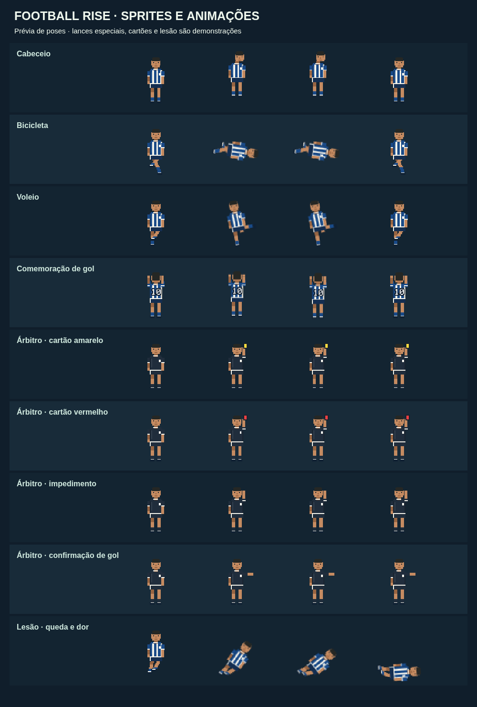

## Novo jogador em pixel art — frente

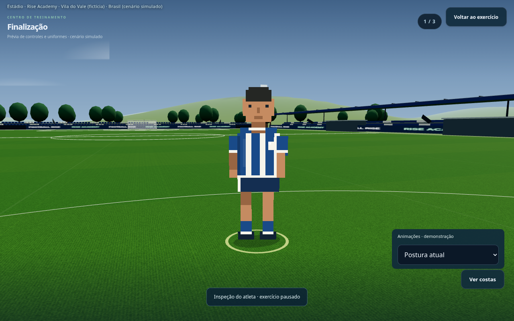

## Uniforme principal — número 99

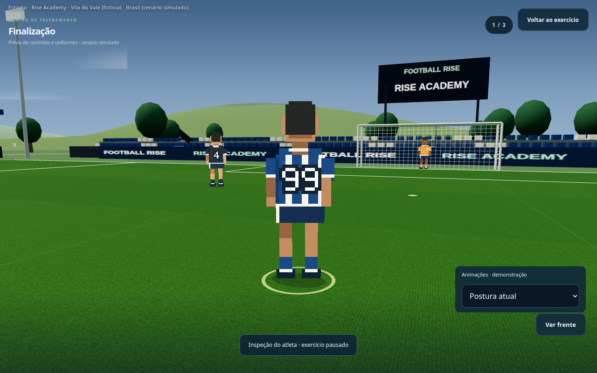

## Uniforme visitante — número 10

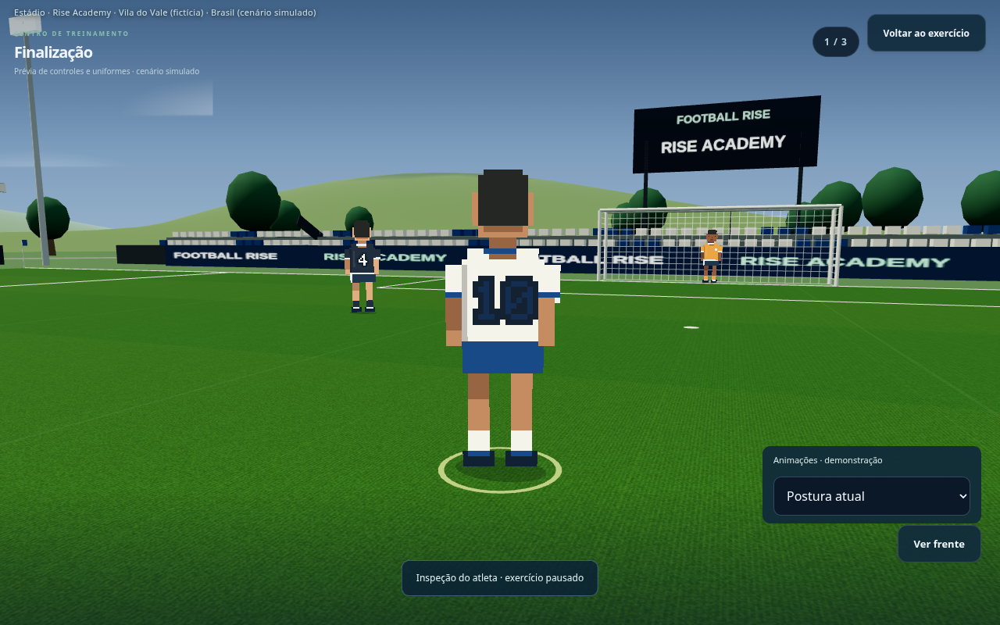

## Uniforme alternativo — número 7

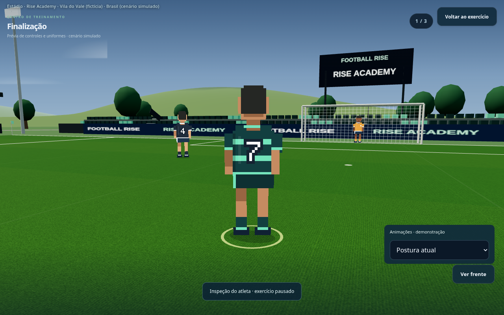

## Mira e força no mesmo gesto

## Condução por direcional no campo

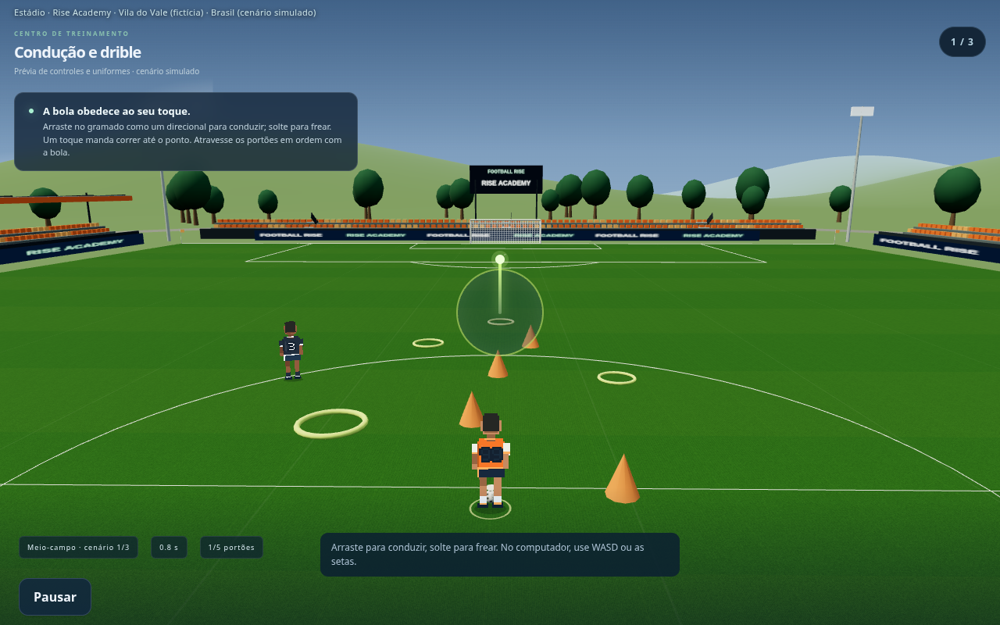

## Revisão de gol — bola inteira além da linha

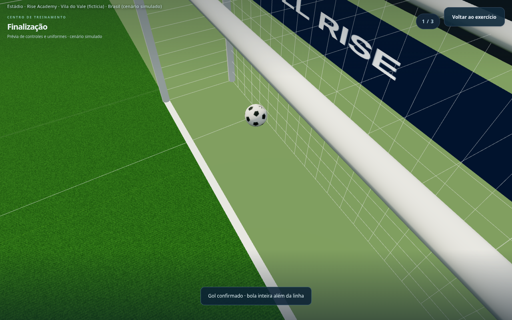

[Baixar as novas imagens](previas-pixel-art.zip)

Prévias anteriores de estádios e competições

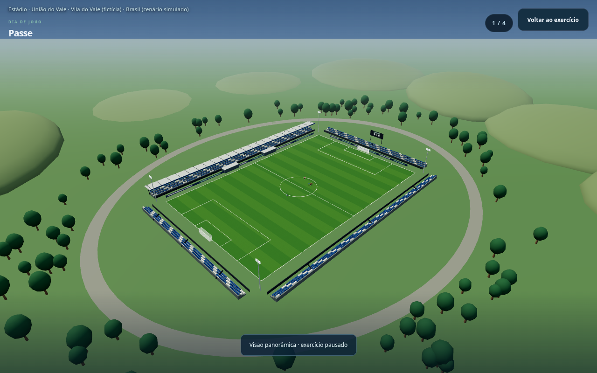

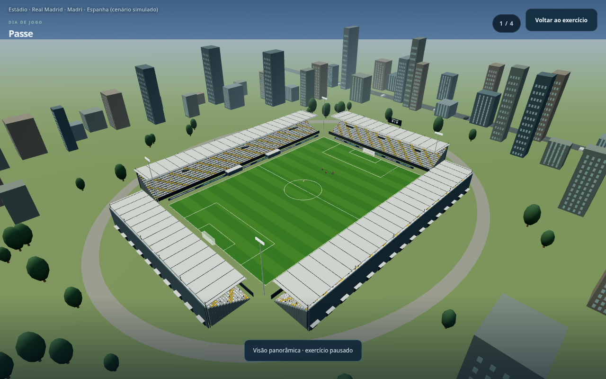

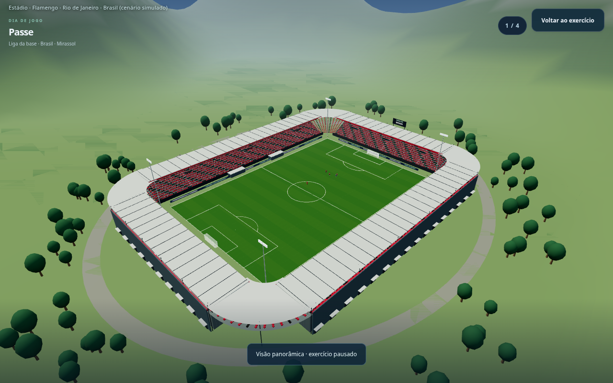

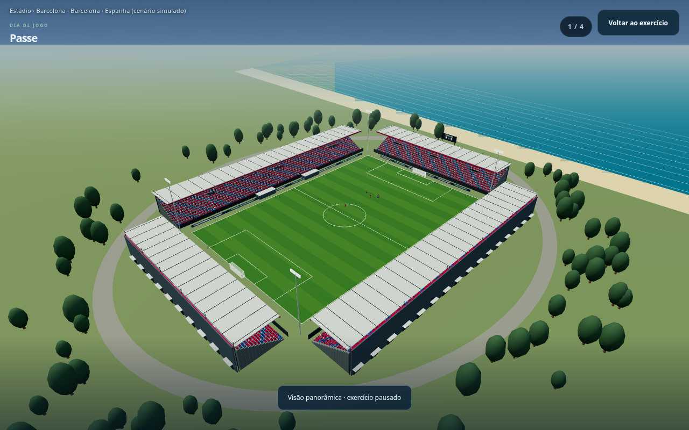

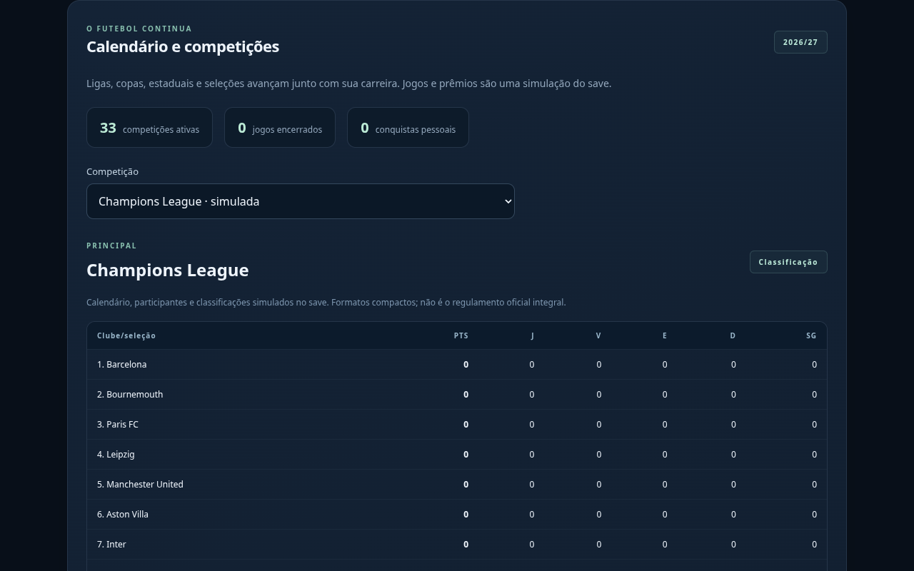

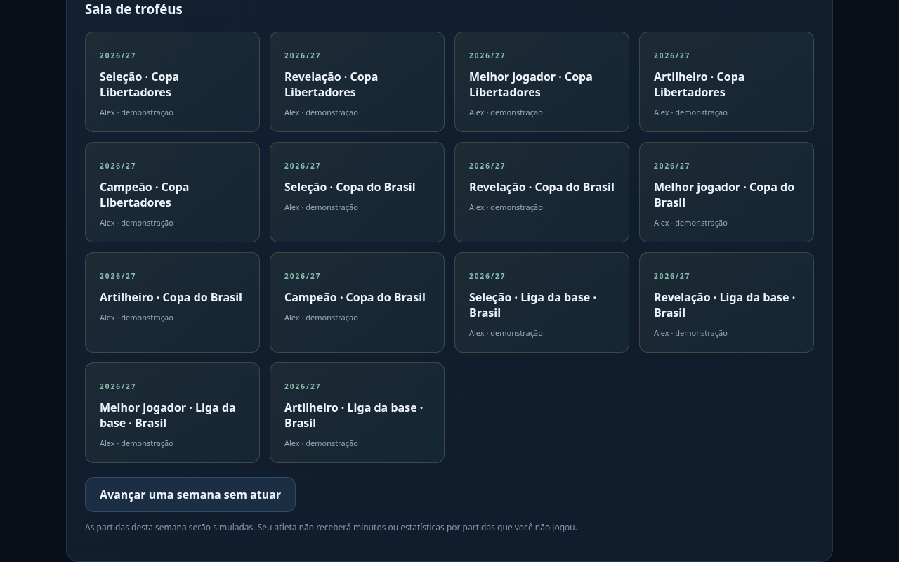

