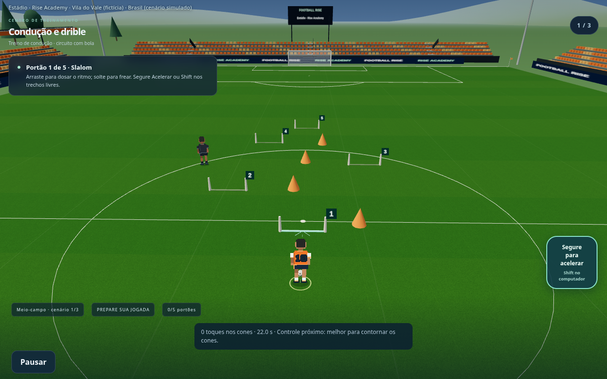
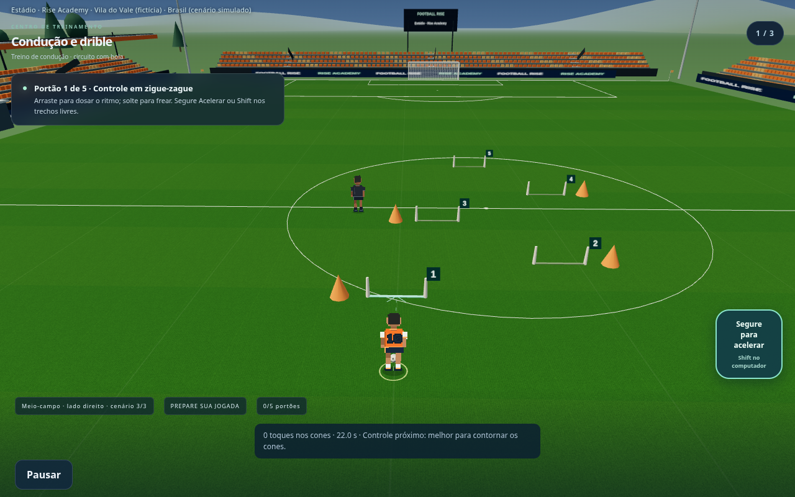
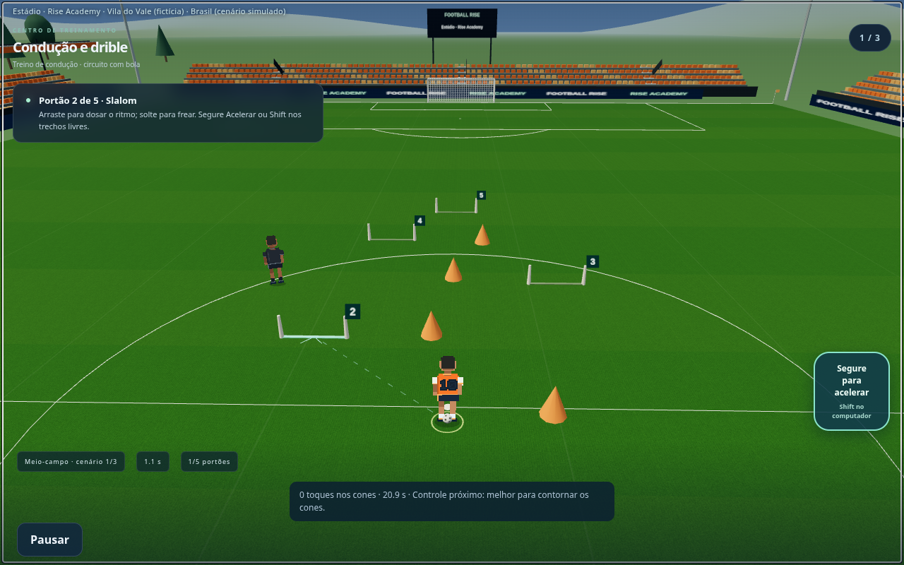
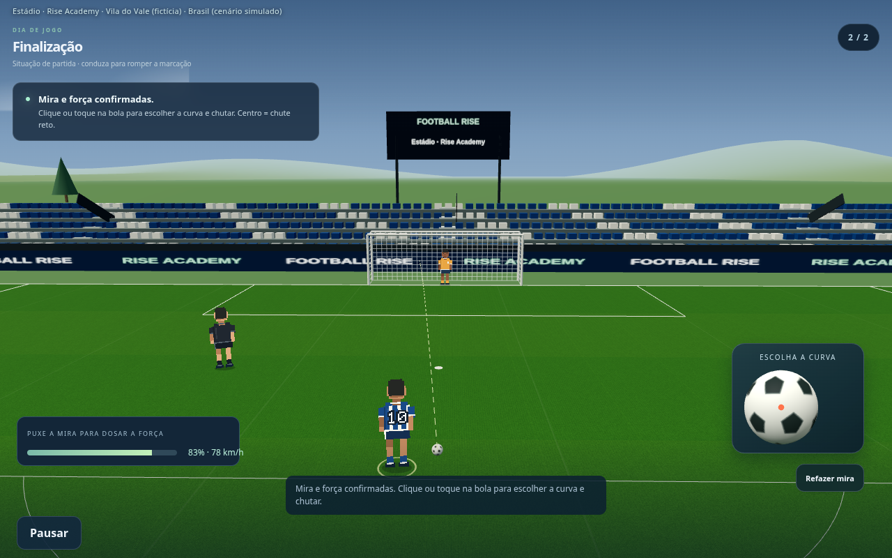
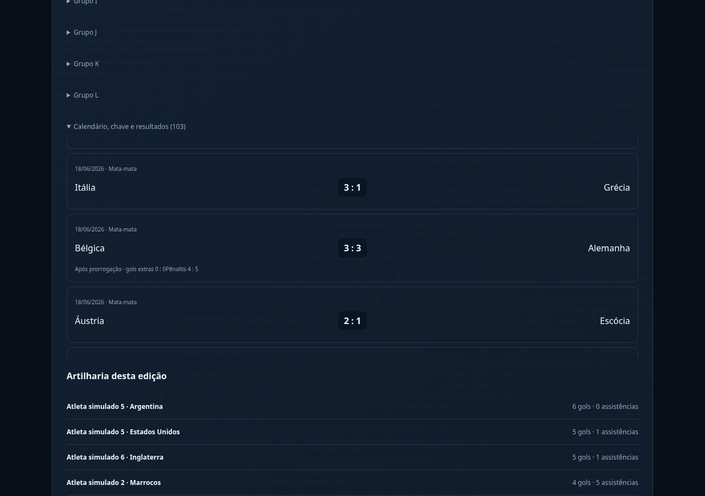

# Condução — variações e continuidade

Capturas do renderer do jogo; não são imagens conceituais.

## Slalom

## Cortes

## Zigue-zague

## Bola próxima ao pé

## Finalização após condução
A próxima oportunidade usa a posição de saída da bola. Mira e força continuam em um só gesto; depois aparece a bola ampliada para escolher a curva, sem alvo circular no final da mira.

## Prorrogação

[Voltar à galeria](README.md)
