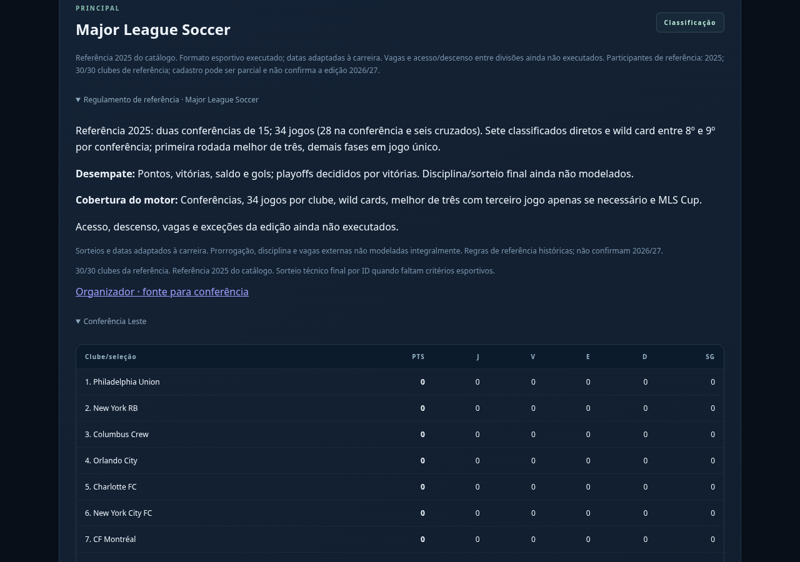
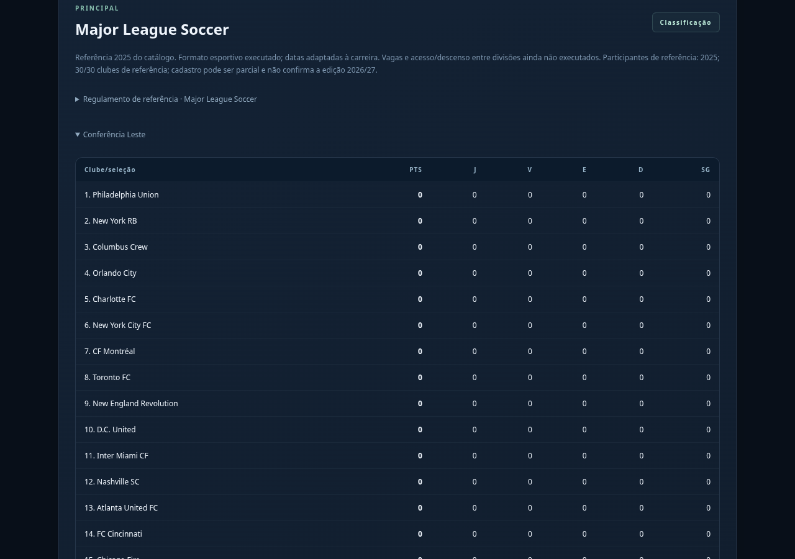
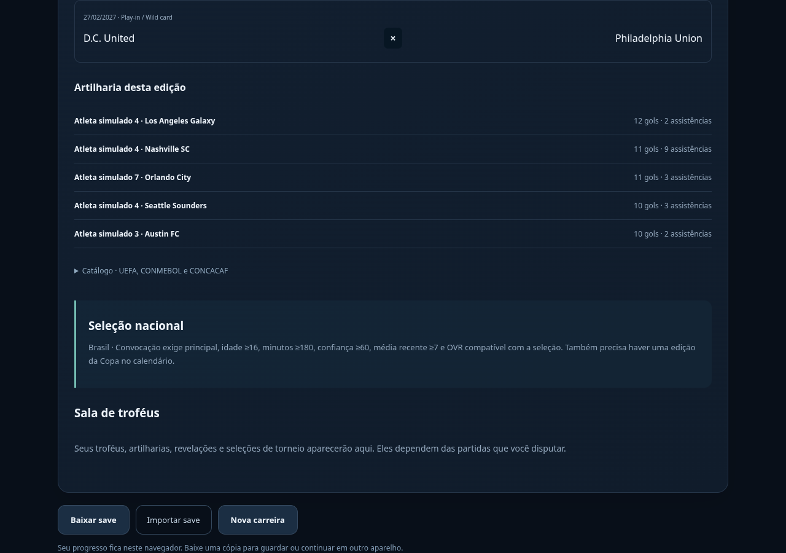
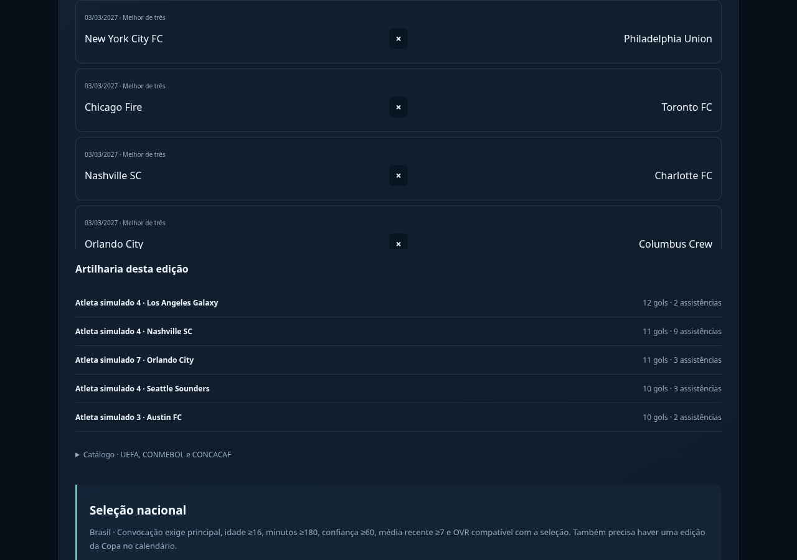
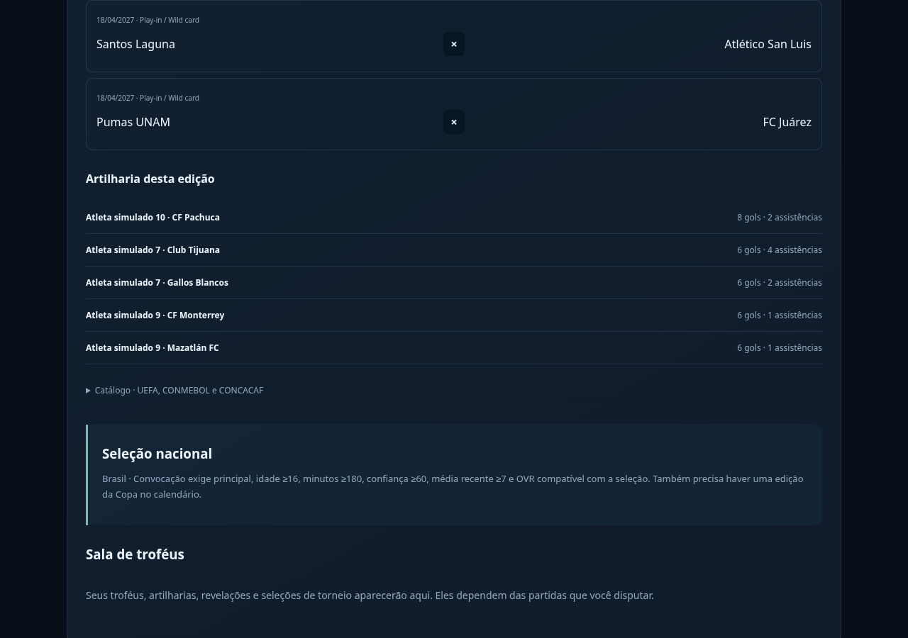
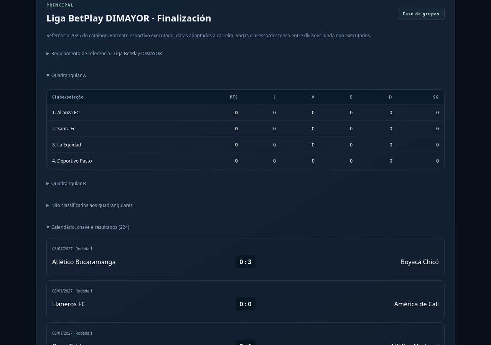
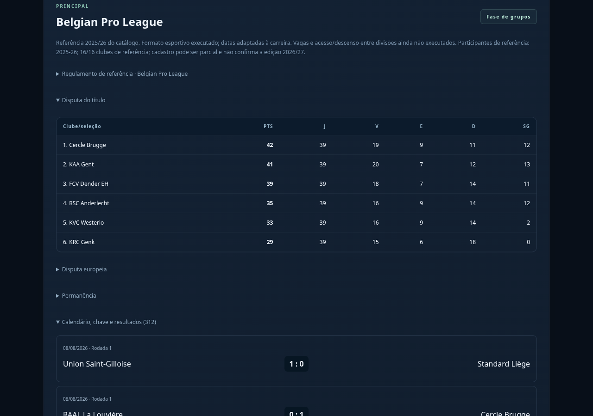
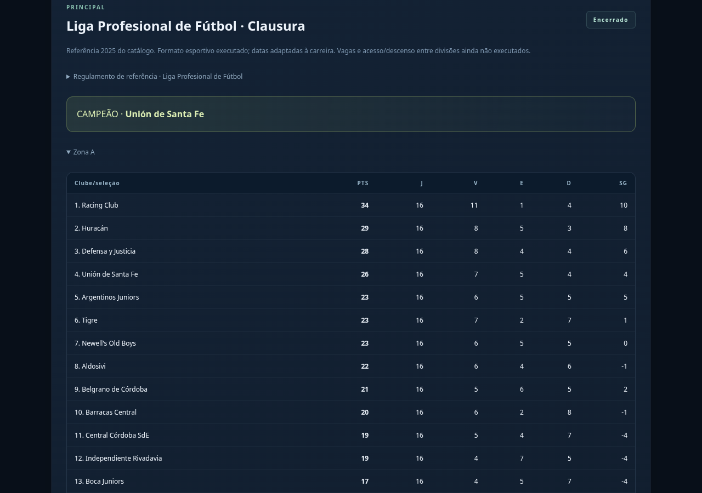
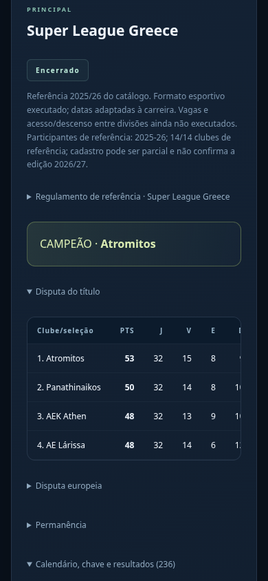

# Football Rise — seis formatos especiais funcionando

**Imagens reais da versão em desenvolvimento. O jogo público ainda aguarda aprovação visual.**

Foram implementados os formatos disponíveis de **MLS (2025), Argentina (2025), Colômbia (2025), México (2024/25), Bélgica e Grécia (2025/26)**. São referências históricas explícitas; não representam uma conferência integral de regulamentos de 2026/27.

## MLS: conferências, wild cards e melhor de três

34 jogos por clube; conferências reais Leste/Oeste; sete vagas diretas e wild card entre 8º e 9º. A primeira rodada é melhor de três, com terceiro jogo apenas se necessário. Depois, semifinais/finais de conferência e MLS Cup.

## México: Apertura, Clausura e play-in

Torneios independentes; seis vagas diretas; 7×8, 9×10 e repescagem pela última vaga. Quartas/semifinais resemeadas e em ida/volta, com vantagem da classificação em empate agregado; na final não há essa vantagem.

## Colômbia: quadrangulares e final em dois jogos

Apertura e Finalización têm campeões próprios. Após 20 partidas por clube, oito avançam aos quadrangulares com pontos zerados. Cabeças de chave têm vantagem no empate em pontos; os vencedores fazem final em ida/volta.

## Bélgica: grupos de título, Europa e permanência

30 jogos iniciais; divisão 6/6/4; pontuação dividida por dois e arredondada para cima nos dois primeiros grupos. A permanência mantém a pontuação integral.

## Argentina: dois campeões por temporada

Zonas A/B de 15; 16 jogos por clube, incluindo dois interzonais. Oito primeiros por zona disputam o mata-mata em jogo único; final sem vantagem de mando na simulação. Apertura e Clausura possuem resultados e troféus separados.

## Grécia no celular

26 jogos iniciais; grupos 4/4/6. Apenas o grupo 5–8 recebe metade dos pontos, arredondada para cima. Campeão sai do grupo de título.

## Validação e limites

Testes automáticos, build e navegador passaram. As nove edições especiais encerraram com campeão, preservando saves anteriores e retomada determinística. O teste de navegador também salvou/recarregou o mundo completo de aproximadamente 11 MB e conferiu o layout móvel.

Calendários usam datas adaptadas à carreira. Sorteios são simulados; acesso/descenso, vagas externas, repescagens europeias, prorrogação e critérios disciplinares específicos continuam pendentes. Elencos novos continuam sem jogadores reais inventados.

[Baixar as nove imagens](previas-formatos-especiais.zip) · [Regras e cobertura detalhadas](regulamentos-cobertura-6-ligas.md) · [Prévia anterior dos regulamentos](previas-regulamentos-v1.md) · [Estádios e torcida](previas-identidades.md) · [Treinos e VAR](previas-treinos.md)
