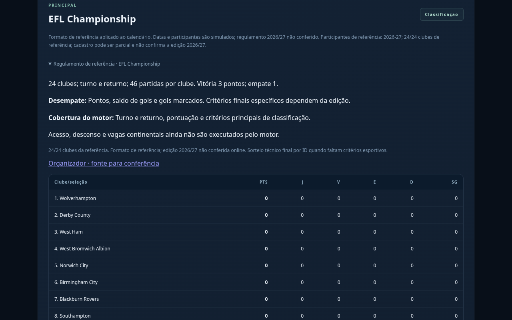
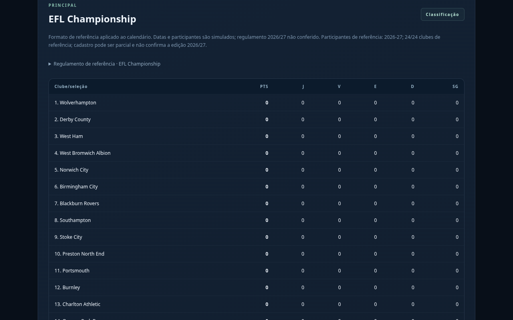
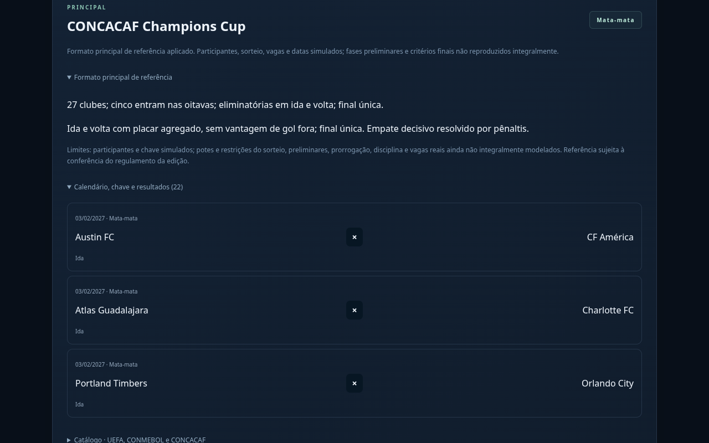
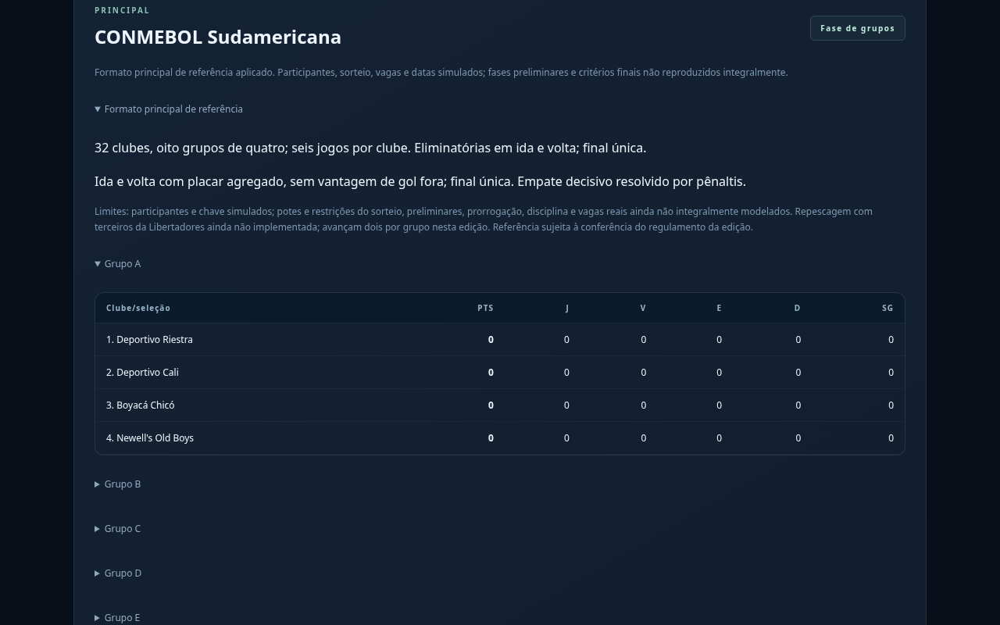
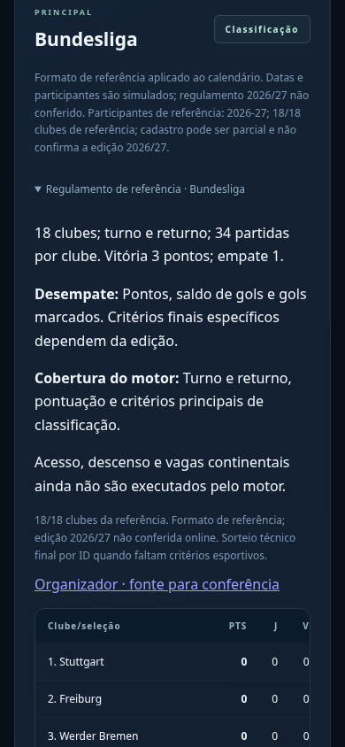

# Football Rise — nomes reais e regras de referência

**Prévia real da versão em desenvolvimento. O jogo público ainda não foi atualizado.**

O cadastro reúne as 26 divisões disponíveis com nomes reais, formato de referência, critérios de desempate e indicação do que o motor executa. O catálogo maior mantém 106 associações e o pacote de 526 clubes. Os participantes continuam identificados pelo ano da fonte; dados históricos não foram anunciados como elencos de 2026/27.

## EFL Championship: 24 clubes, 46 partidas por clube

## CONCACAF Champions Cup: ida e volta

## CONMEBOL Sudamericana

## No celular

## O que já funciona

Turno e returno em 18 divisões regulares; divisões finais de Escócia e Áustria com transporte dos pontos; eliminatórias continentais com agregado e finais próprias; fase UEFA com mandos equilibrados; grupos de cinco na América Central e Caribe. Saves anteriores mantêm seu calendário. Testes de regras, build e teste no navegador passaram.

## O que ainda falta

MLS, Argentina, Colômbia, México, Bélgica e Grécia têm o formato histórico descrito, mas a execução continua simplificada. Acesso/descenso, vagas, preliminares, prorrogação e critérios finais específicos ainda não estão completos. Estaduais e copas nacionais continuam compactos. A repescagem da Sudamericana com a Libertadores e a revisão da Leagues Cup permanecem pendentes.

A rede bloqueou consultas aos sites oficiais com HTTP 403; **não há confirmação integral dos regulamentos de 2026/27**. Links dos organizadores constam na tela para conferência.

[Baixar estas cinco imagens](previas-regulamentos.zip) · [Detalhes da implementação e limites](regulamentos-cobertura-v1.md) · [Prévia anterior do catálogo](previas-ligas-catalogo.md) · [Estádios e torcida](previas-identidades.md) · [Treinos e VAR](previas-treinos.md)
