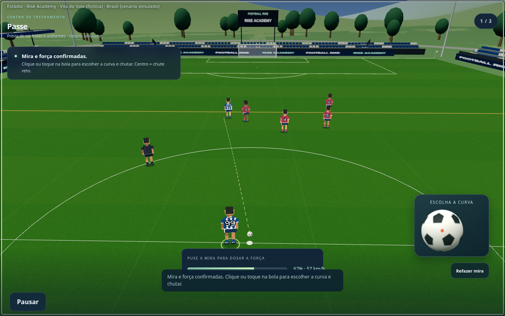
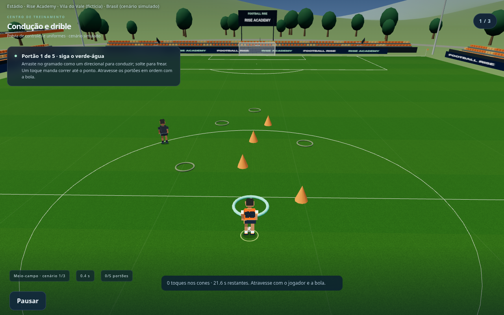
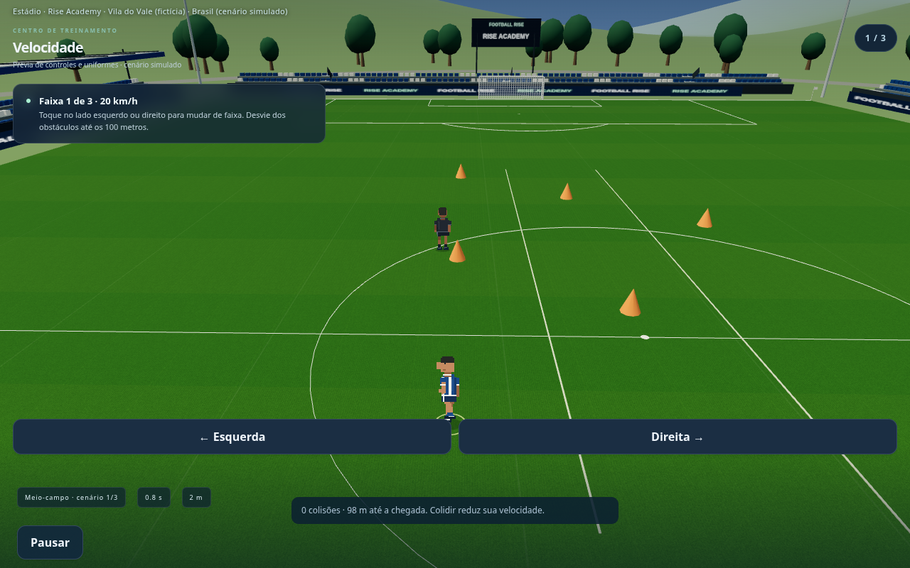
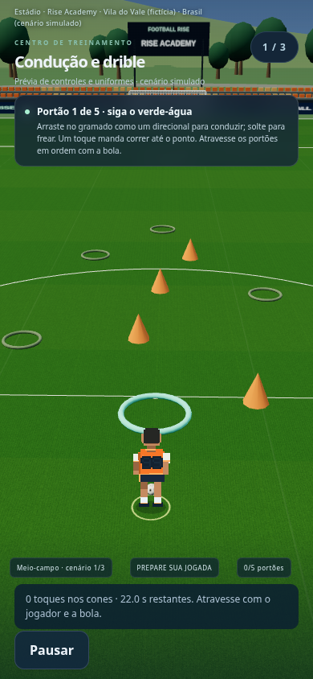

# Football Rise — equipe voltada às telas e ajustes nos treinos

**Capturas reais da versão em desenvolvimento para revisão. O jogo público ainda não foi atualizado.**

VAR, AVAR e operador de replay aparecem de costas, sentados diante dos monitores, com as mãos no console. As placas identificam cada função; a roupa continua lisa.

## Equipe do VAR voltada para os monitores

## Passe — câmera mais alta e leitura do meio-campo

## Visão — companheiros, defensores e linha de impedimento

## Condução — próximo portão destacado

O verde-água indica o portão atual. A interface mostra ordem, tempo restante e contatos nos cones. A bola e o atleta precisam atravessar juntos.

## Velocidade — faixas, aceleração e colisões

O atributo de velocidade determina o teto da corrida. O jogador acelera, perde ritmo nas colisões e volta a acelerar. Faixas, km/h e distância restante aparecem no exercício.

## Treino no celular

[Prévia anterior da mira](previas-mira-var.md) · [Uniformes da arbitragem](previas-arbitragem.md) · [Sequência do VAR](previas-var.md) · [Jogadores e animações](previas-pixel-art.md)
